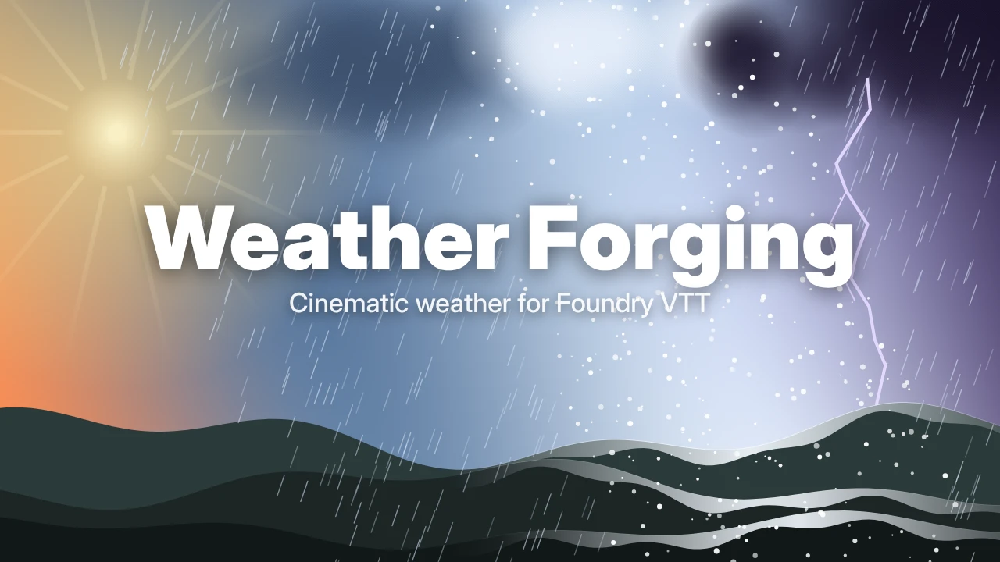

# Weather Forging



Kinowa, niezależna od systemu pogoda dla **Foundry VTT v14**: efekty na mapie,
interfejs reagujący na pogodę i stan pogody dostępny dla innych systemów
i modułów.

> 🚧 Wczesna wersja (0.1.x): szkielet modułu i prototyp efektów.
> Plany i decyzje: [DESIGN.md](DESIGN.md).

## Instalacja

W Foundry (także na The Forge): *Add-on Modules → Install Module* i wklej
adres manifestu:

```
https://github.com/V-Cancrosa/Weather_Forging/releases/latest/download/module.json
```

## Użycie

- MG: **Sterowanie sceną → Oświetlenie → ikona chmury** otwiera panel pogody.
  Wybierz pogodę i czas przejścia.
- **Miejsce bez pogody** (wnętrze, jaskinia, zadaszenie): narysuj Region,
  dodaj mu zachowanie **Suppress Weather** („Wyłącz pogodę”). W tym obszarze
  znikną opady, śnieg i wilgoć na ziemi. Wyłączenie zachowania przywraca pogodę.
- Śnieg i wilgoć pokrywają tło sceny, poziomy i kafelki (także dachy).
- **Edytor pogody** (przycisk w panelu): każdy parametr na suwaku, zastosowanie
  na scenie i zapis jako własny preset.
- **Widżet pogody** widoczny dla wszystkich graczy: można go przeciągnąć,
  a MG otwiera nim panel jednym kliknięciem.
- Pogoda przyciemnia scenę przez oświetlenie Foundry, a błyskawice ją rozświetlają
  (ustawienie świata „Pogoda wpływa na oświetlenie sceny”).
- Ustawienia klienta: jakość efektów, interfejs reagujący na pogodę,
  ograniczenie błysków.

### Zgłaszanie problemów

W konsoli przeglądarki (F12) wpisz:

```js
game.modules.get("weather-forging").api.diagnose()
```

i dołącz wynik do zgłoszenia.

### Wczesne API (niestabilne)

```js
const wf = game.modules.get("weather-forging").api;
wf.getWeather(canvas.scene);                         // stan w tej chwili
await wf.setWeather(canvas.scene, "storm", { duration: 30 });
Hooks.on("weather-forging.changed", (scene, target, transition) => { /* … */ });
```

## Rozwój

```bash
npm test   # testy modelu pogody (Node 20+)
```

Wydanie: podbij `version` w `module.json` i wypchnij zmiany na `main`.
Workflow sam przetestuje moduł, zbuduje `module.zip` i opublikuje release
`vX.Y.Z` (jeśli dla tej wersji jeszcze nie istnieje).

## Licencja

[MIT](LICENSE)
